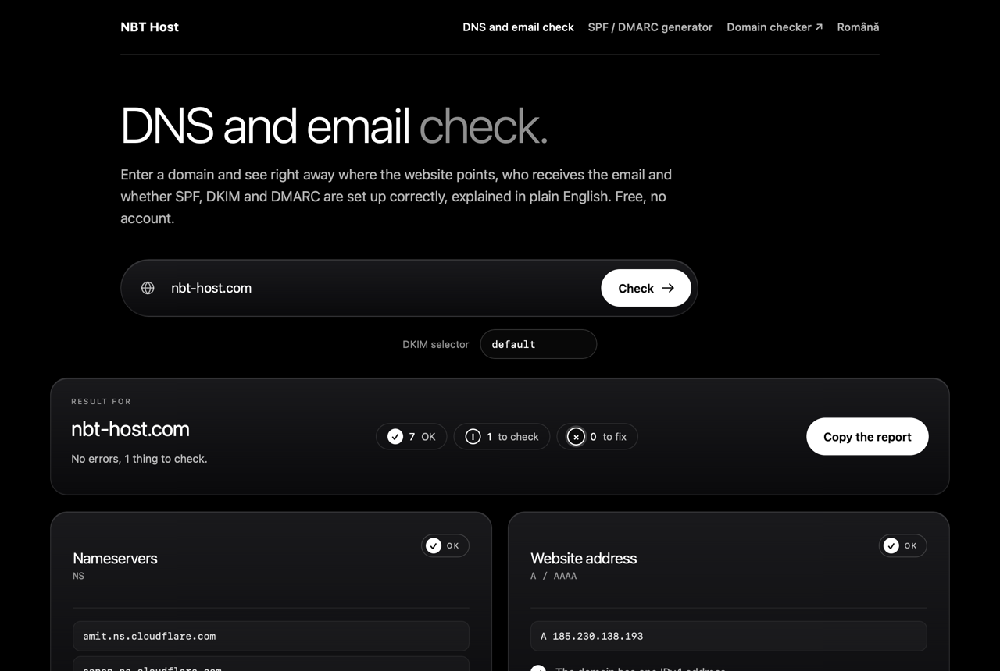

# verificare-dns-email

**Free, open source DNS and email checker (A, AAAA, NS, MX, SPF, DKIM, DMARC, CAA) and SPF / DMARC record generator that runs entirely in the browser.** Interface in Romanian and English. Maintained by [NBT Host](https://nbt-host.com/), a European web hosting provider with servers in the EU.



- **Live:** [nbt-host.com/en/tools/dns-email-checker](https://nbt-host.com/en/tools/dns-email-checker) · [nbt-host.com/en/tools/spf-dmarc-generator](https://nbt-host.com/en/tools/spf-dmarc-generator) (English) · [nbt-host.com/instrumente/verificare-dns-email](https://nbt-host.com/instrumente/verificare-dns-email) (Romanian)
- **No backend.** DNS questions go straight from the visitor's browser to Cloudflare DNS-over-HTTPS (`cloudflare-dns.com`), with Google Public DNS (`dns.google`) as a fallback. Nothing is stored, there are no cookies and no analytics.
- **The generator is fully offline:** nothing leaves the page.
- **No build step, no dependencies:** plain HTML, CSS and one vanilla JavaScript file per language.

## What the checker reports

| Record | What it tells you | What it flags |
|---|---|---|
| NS | where the domain's DNS is managed | missing nameservers, SERVFAIL (often a broken DNSSEC setup at the registrar) |
| A / AAAA | where the website points | no A record; missing IPv6 is shown as information, not as an error |
| MX | who receives email for the domain | no MX record |
| SPF | which servers may send on behalf of the domain | no SPF, more than one SPF record, more than 10 DNS lookups (nested `include`s counted), an `include` without a valid SPF record, `+all` or `?all` |
| DKIM | whether a public key exists for the selector | tries `default`, `hostingcp`, `google`, `selector1`, `selector2` and any selector you type; shows the key size |
| DMARC | your policy for messages that fail SPF and DKIM | no DMARC, `p=none` (monitoring only), no `rua=` reports, `pct` below 100 |
| CAA | which certificate authorities may issue SSL certificates | CAA records that would block Let's Encrypt |

Every finding is explained in plain language, with a link to a step-by-step guide. **Copy the report** puts the whole result on the clipboard as text, ready to paste into a support ticket.

## What the generator builds

Tick who sends email for the domain (the domain's own mail server, a fixed IP, Google Workspace, Microsoft 365, any other `include:`) and pick a DMARC policy. You get the TXT records ready to copy, with warnings for the usual mistakes: more than 10 DNS lookups, a second SPF record, records longer than 255 characters, `-all` before every sender is listed, `p=reject` too early, no report address, reports sent to another domain without the authorisation record.

## Run it

Open `index.html` (Romanian) or `en/index.html` (English) in a browser, or serve the folder:

```bash
python3 -m http.server 8000
# http://localhost:8000/        Romanian
# http://localhost:8000/en/     English
```

It also works on GitHub Pages (Settings → Pages → Deploy from a branch → `main` / root). The pages carry `rel="canonical"` to the live versions on nbt-host.com, so a copy does not compete with them in search results.

## Files

```
index.html                    Romanian: DNS and email check
generator-spf-dmarc.html      Romanian: SPF / DMARC generator
en/index.html                 English: DNS and email check
en/spf-dmarc-generator.html   English: SPF / DMARC generator
assets/instrumente.js         logic + Romanian texts
assets/instrumente.en.js      logic + English texts
assets/baza.css, instrumente.css
```

The two JavaScript files share the same logic; only the texts differ. A fix in one belongs in the other too.

## Privacy

The only data that leaves the browser is the DNS name being checked (for example `_dmarc.example.com`), sent to Cloudflare's and, if that fails, Google's public DNS-over-HTTPS resolvers. Their own privacy policies apply to those requests. The page itself sets no cookies and uses no storage.

## Limits

- DKIM keys can only be found under a known selector. If the domain uses another one, read it from a message header (`DKIM-Signature: … s=<selector>`) and type it in.
- The results are what public DNS answers at that moment. After a change, resolvers may keep the old answer until the TTL expires.
- The "is this domain available?" check from nbt-host.com is not included: it asks the NBT Host server.

---

## Pe scurt, în română

Instrumentele gratuite de pe [nbt-host.com/instrumente](https://nbt-host.com/instrumente/), cu cod deschis: **verificarea DNS și email** (unde arată site-ul, cine primește emailurile, dacă SPF, DKIM și DMARC sunt puse corect) și **generatorul SPF și DMARC**. Totul rulează în browser, fără cont și fără să păstrăm ceva. Varianta în română e în rădăcină (`index.html`), cea în engleză în `en/`.

Ghiduri pas cu pas: [mailuri în spam: SPF, DKIM, DMARC](https://nbt-host.com/ghiduri/mailuri-in-spam-spf-dkim-dmarc) · [DMARC pas cu pas](https://nbt-host.com/ghiduri/dmarc-pas-cu-pas).

## Licence

MIT © 2026 [NBT Host](https://nbt-host.com/). See [LICENSE](LICENSE).

Issues and pull requests are welcome; see [CONTRIBUTING.md](CONTRIBUTING.md). Security reports: [SECURITY.md](SECURITY.md).
